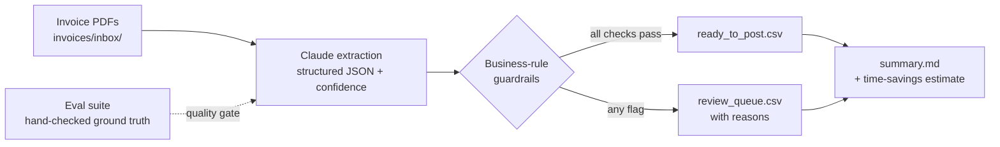

# AI Invoice Processing Pipeline

**Claude reads vendor invoices. Business rules decide what's safe to post. People review the rest.**

An end-to-end, AI-assisted accounts-payable workflow that runs on GitHub Actions: drop invoice PDFs into a folder, and the pipeline extracts the data, assigns a GL code, checks it against finance controls, and produces a ready-to-post file plus a human review queue — with an eval suite that blocks the run if quality slips.

> All invoices in this repo are fictional and generated by `scripts/make_sample_invoices.py`.

---

## The business problem

In a small finance office, every vendor invoice is opened, read, keyed into the accounting system, coded to a GL account, and checked for duplicates and approval limits by hand. As Finance Coordinator at a nonprofit, I did this work myself. It's slow, it's repetitive, and the errors that slip through (a duplicate paid twice, a bill over the approval limit posted without sign-off) are expensive.

The goal isn't to remove people from AP. It's to move them from **keying data** to **reviewing exceptions**.

## How it works



| Step | What happens | Why it's built this way |
|---|---|---|
| **Extract** (`src/extract_claude.py`) | Each PDF goes to Claude, which must answer through a fixed JSON schema (forced tool call): vendor, invoice #, dates, line items, total, GL category, a confidence score, and notes. | A schema means no free-text parsing downstream. Claude is told to copy values exactly and use `null` rather than guess. |
| **Validate** (`src/validate.py`) | Plain code checks every extraction against finance controls. | The model reads; deterministic rules decide. Controls are auditable and don't drift. |
| **Route & report** (`src/report.py`) | Clean invoices go to a ready-to-post CSV; anything flagged goes to a review queue with the reason in plain English. | Reviewers see *why*, not just *that*, so a review takes seconds. |
| **Quality gate** (`evals/run_evals.py`) | Before any processing, the extractor is scored against hand-checked answers. Any "unsafe pass" fails the build. | You don't ship an AI workflow you haven't measured. |

### Guardrails (finance controls)

Every rule lives in [`config.yaml`](config.yaml), so a finance lead can change thresholds without touching code.

| Control | Flag raised when… |
|---|---|
| Duplicate detection | Same vendor + invoice # (or vendor + date + amount when the # is missing) |
| Required fields | Vendor, invoice #, invoice date, due date or total is missing |
| Math check | Line items don't add up to the stated total |
| Approval threshold | Total ≥ $2,500 → manager sign-off |
| Vendor master | Vendor isn't on the approved list (W-9 / setup needed) |
| Confidence floor | The model's confidence is below 0.85 |

The sample inbox includes one invoice designed to trip each control. See [`reports/summary.md`](reports/summary.md) for a real run.

## Measuring it: evals

[`evals/expected.json`](evals/expected.json) holds hand-checked answers for 10 invoices, including 2 from a vendor template the system has never seen ([`evals/hard_cases/`](evals/hard_cases)). The eval reports field accuracy, routing accuracy, and the metric that matters most:

> **Unsafe passes**: invoices that should have gone to a person but were marked ready to post. This must be **0**, and the GitHub Action fails if it isn't.

| Extractor | Field accuracy | Correct routing | Unsafe passes |
|---|---:|---:|---:|
| Rule-based template parser (the "before" baseline) | 83% | 10/10 | 0 |
| Claude | _run `python evals/run_evals.py --mode claude` and record here_ | | |

The baseline is perfect on the template it was written for and **gets 1 of 6 fields** on an unfamiliar layout ([details](evals/results_offline.md)). It only stays safe because the guardrails catch its low confidence. This is the core argument for using a model: real vendors don't share a template.

## Estimated impact

The summary report scales each run to monthly volume using assumptions in `config.yaml` (150 invoices/month, 6 min manual vs. 0.5–3 min review). On the deliberately problem-heavy sample set, that's roughly **15 → 5 hours/month**. These are planning assumptions, not measurements; a real rollout would time the current process first (see the rollout plan).

## Run it

```bash
pip install -r requirements.txt
python scripts/make_sample_invoices.py      # regenerate the fictional invoices

python src/pipeline.py --mode offline       # no API key needed
export ANTHROPIC_API_KEY=sk-ant-...
python src/pipeline.py                      # uses Claude when a key is set

python evals/run_evals.py --mode claude     # score it
```

**On GitHub:** add `ANTHROPIC_API_KEY` under *Settings → Secrets and variables → Actions*. Pushing PDFs to `invoices/inbox/` runs the eval gate, then the pipeline, posts the summary to the Actions run page, and commits the reports back. Without the secret, it runs in offline mode, so the demo always works.

## Data privacy

- Only fictional invoices are committed; `invoices/private/` is git-ignored.
- In production, invoices would come from a secured mailbox or document store, not a public repo, and the API would be used under a zero-data-retention agreement where required.
- Bank details on invoices are never extracted or stored; the schema doesn't ask for them.

## Rolling it out

The code is the easy part. See [`docs/rollout-plan.md`](docs/rollout-plan.md) for how I'd introduce this to a real finance team: baseline measurement, a shadow-mode pilot, success criteria, training, and who owns what.

## Limitations & next steps

- Single-page PDFs only; multi-page and scanned/photographed invoices need testing.
- 10 test cases is a demo; production would need 100+ real (redacted) invoices from the top vendors.
- Next: QuickBooks/Xero export format, email-inbox intake, and a reviewer feedback loop that adds corrected invoices to the eval set.

---

*Built by Gavin Palm as part of a portfolio on practical AI implementation. Pairs with [intake-automation](https://github.com/gavinpalm-ux/intake-automation).*
